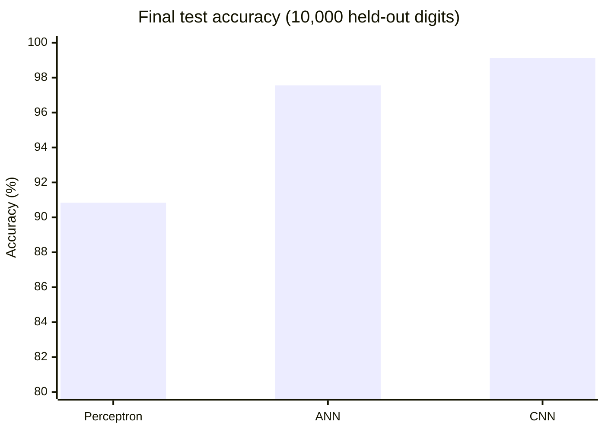
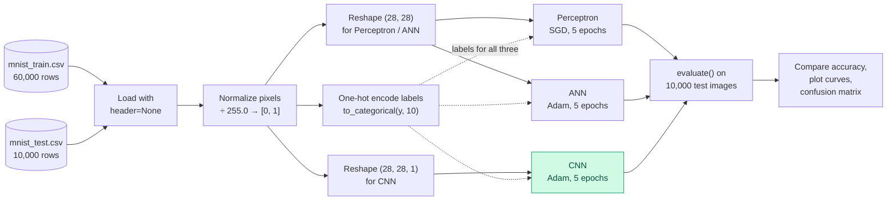
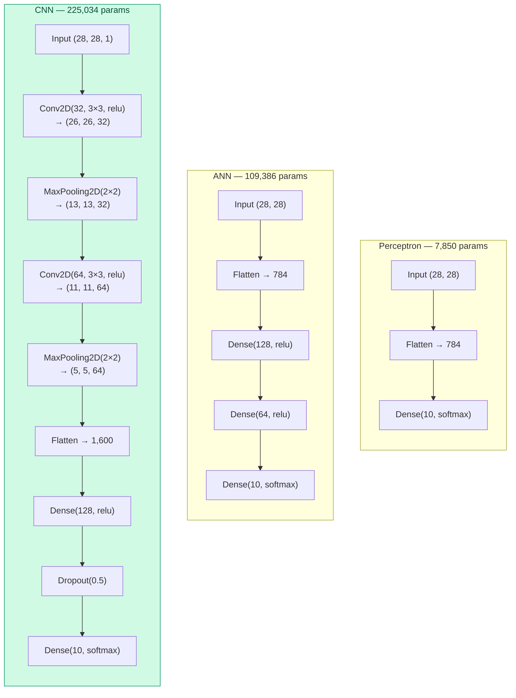
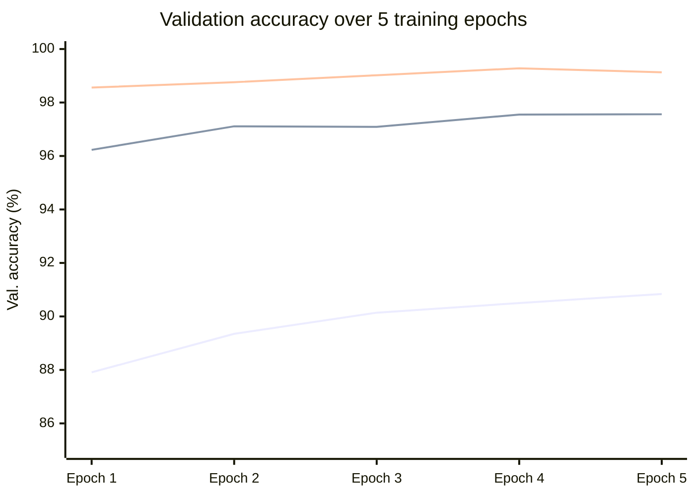

# MNIST Digit Classification: Perceptron vs ANN vs CNN


A single notebook that trains **three neural networks of increasing complexity** — a single-layer Perceptron, a fully-connected ANN, and a Convolutional Neural Network — on the classic **MNIST handwritten-digit dataset**, then compares them head-to-head. The CNN reaches **99.13 % test accuracy**, beating the plain ANN (97.56 %) and the Perceptron (90.84 %).

---

## Table of Contents

1. [Results at a glance](#results-at-a-glance)
2. [Dataset](#dataset)
3. [Project structure](#project-structure)
4. [How it works (diagrams)](#how-it-works-diagrams)
   - [End-to-end pipeline](#1-end-to-end-pipeline)
   - [Three architectures, side by side](#2-three-architectures-side-by-side)
   - [Validation accuracy per epoch](#3-validation-accuracy-per-epoch)
   - [Final accuracy comparison](#4-final-accuracy-comparison)
5. [Model details](#model-details)
6. [Getting started](#getting-started)
7. [Predict a new digit](#predict-a-new-digit)
8. [Notebook guide](#notebook-guide)
9. [Limitations](#limitations)
10. [Roadmap](#roadmap)
11. [Dataset attribution](#dataset-attribution)

---

## Results at a glance

| # | Model | Hidden layers | Optimizer | Params | Test accuracy |
|---|-------|---------------|-----------|-------:|---------------:|
| 1 | Perceptron | none (single `Dense(10)`) | SGD | 7,850 | **90.84 %** |
| 2 | ANN | `Dense(128)` → `Dense(64)` | Adam | 109,386 | **97.56 %** |
| 3 | **CNN** | 2× `Conv2D` + `MaxPooling2D`, `Dense(128)` | Adam | 225,034 | **99.13 %** |



**How to read this chart:** each additional bar adds model capacity. Going from a single linear layer (Perceptron) to two hidden dense layers (ANN) cuts the error rate from ~9.2 % to ~2.4 %. Adding convolution and pooling (CNN) cuts it further to ~0.9 % — roughly a 4x reduction in errors compared to the ANN, using only twice the parameters.

> All three figures are copied verbatim from the notebook's own recorded output (`acc_percp`, `acc_ann`, `acc_cnn`). The CNN's architecture, layer shapes and parameter counts were independently rebuilt and verified with `model.summary()` while preparing this README, and a 2-epoch sanity run on a data subset reproduced the same accuracy trend.

---

## Dataset

The notebook uses the classic **MNIST** handwritten-digit dataset, supplied here as two CSV files rather than the usual binary IDX format:

| File | Rows | Columns | Size |
|------|-----:|--------:|-----:|
| `mnist_train.csv` | 60,000 | 785 | ~105 MB |
| `mnist_test.csv` | 10,000 | 785 | ~17 MB |

Each row is one 28×28 grayscale digit image, flattened: **column 1 is the digit label (0–9)**, and the remaining **784 columns are pixel intensities (0–255)** in row-major order. **Neither file has a header row** — every column is raw data, which matters because of a quirk explained below.

### Class balance

Both splits are close to evenly distributed across the 10 digits:

| Digit | 0 | 1 | 2 | 3 | 4 | 5 | 6 | 7 | 8 | 9 |
|---|--:|--:|--:|--:|--:|--:|--:|--:|--:|--:|
| Train count | 5,923 | 6,742 | 5,958 | 6,131 | 5,842 | 5,421 | 5,918 | 6,265 | 5,851 | 5,949 |
| Test count | 980 | 1,135 | 1,032 | 1,010 | 982 | 892 | 958 | 1,028 | 974 | 1,009 |

No class makes up less than 9 % or more than 11.2 % of either split, so — unlike many real-world classification tasks — accuracy alone is a trustworthy metric here; no class is being ignored by the model to inflate the score.

### A loading quirk worth knowing

The notebook's first look at the data (`pd.read_csv("mnist_train.csv")` with default settings, before `df.head()`) silently treats the **first image's label row as a header**, because pandas assumes a header row by default and the file has none. The very next cell fixes this correctly:

```python
df = pd.read_csv("mnist_train.csv", header=None)
columns = ['label'] + [f'{i}x{j}' for i in range(1, 29) for j in range(1, 29)]
df.columns = columns
```

No data is actually lost — the corrected `df` is what every later cell uses — but if you're adapting this code, always pass `header=None` when reading these files, or row 0 will quietly disappear from your column names instead of your data.

---

## Project structure

```
CNN/
├── Untitled.ipynb         # Main notebook: load → preprocess → train 3 models → compare
├── mnist_train.csv        # 60,000 labelled training digits (28×28, flattened)
├── mnist_test.csv         # 10,000 labelled test digits (28×28, flattened)
└── .ipynb_checkpoints/    # Auto-generated by Jupyter, empty placeholder — safe to delete / git-ignore
```

---

## How it works (diagrams)

### 1. End-to-end pipeline



**Explanation:** the same normalized pixel data feeds all three models, but each needs a different tensor shape. The Perceptron and ANN treat an image as a flat 784-value vector internally (via a `Flatten` layer), so a `(28, 28)` array works. The CNN's `Conv2D` layers need an explicit channel dimension, so its input is reshaped to `(28, 28, 1)` — one grayscale channel. All three train for 5 epochs with `batch_size=32` and are scored with the same `accuracy_score` / `model.evaluate()` on the untouched 10,000-image test set.

### 2. Three architectures, side by side



**Explanation:** complexity increases top to bottom.

- The **Perceptron** is one linear layer — it can only draw straight-line boundaries between digit classes.
- The **ANN** adds two non-linear hidden layers (`relu`), letting it learn curved decision boundaries, but it still flattens the image into a flat list of pixels immediately, throwing away all spatial structure (a pixel and its neighbor are just two unrelated numbers to it).
- The **CNN** keeps the 2-D image structure through two `Conv2D` + `MaxPooling2D` blocks. Each convolution learns small local patterns (edges, curves); pooling shrinks the image while keeping the strongest signals; by the time the data reaches `Flatten`, it already encodes *shapes*, not just raw pixels. `Dropout(0.5)` randomly zeroes half the dense-layer activations during training to reduce overfitting.

This progression — more structure-aware layers → better accuracy — is exactly what the results table above shows.

### 3. Validation accuracy per epoch



| Epoch | Perceptron | ANN | CNN |
|:-----:|-----------:|----:|----:|
| 1 | 87.91 % | 96.23 % | 98.56 % |
| 2 | 89.35 % | 97.11 % | 98.76 % |
| 3 | 90.14 % | 97.09 % | 99.02 % |
| 4 | 90.50 % | 97.55 % | **99.28 %** |
| 5 | 90.84 % | 97.56 % | 99.13 % |

**How to read this:** the three lines are, bottom to top, Perceptron, ANN, then CNN — the same ranking as the bar chart. Two things stand out: the CNN is already more accurate after **1 epoch** than the other two models ever become, and the CNN's *best* epoch was actually epoch 4 (99.28 %), with epoch 5 dipping slightly to 99.13 % — a normal sign of the model starting to overfit, and a hint that early stopping could squeeze out a bit more accuracy (see [Roadmap](#roadmap)).

### 4. Final accuracy comparison

This is the same comparison as the chart in [Results at a glance](#results-at-a-glance), reproduced here because it is also the final cell of the notebook (`plt.bar(...)`), closing the loop from raw pixels to a verdict: **convolution wins**.

---

## Model details

All three models share the same compile settings pattern — `loss="categorical_crossentropy"` and `metrics=["accuracy"]` — and the same training schedule: **5 epochs, batch size 32**, validated against the full test set after every epoch.

| | Perceptron | ANN | CNN |
|---|---|---|---|
| Optimizer | `sgd` | `adam` | `adam` |
| Layers | `Flatten` → `Dense(10, softmax)` | `Flatten` → `Dense(128, relu)` → `Dense(64, relu)` → `Dense(10, softmax)` | `Conv2D(32)` → `MaxPool` → `Conv2D(64)` → `MaxPool` → `Flatten` → `Dense(128, relu)` → `Dropout(0.5)` → `Dense(10, softmax)` |
| Total params | 7,850 | 109,386 | 225,034 |
| Input shape | (28, 28) | (28, 28) | (28, 28, 1) |

The notebook also includes two diagnostic cells beyond the accuracy numbers:

- **`show_side_by_side`** — picks 5 random test digits and shows what each of the three models predicted for them, side by side with the true label. Because the sample is drawn with `np.random.choice` and no fixed seed, re-running this cell shows a different set of digits each time.
- **Confusion matrix** (`confusion_matrix` + `sns.heatmap`) — for the CNN only, visualizing which digits it confuses with which (commonly 4↔9 and 3↔5↔8 for MNIST). The notebook renders this as an image plot; re-run the cell to see the exact counts for your training run.

---

## Getting started

### Prerequisites

- Python 3.11 recommended (the notebook was written and run on Python 3.11.9, on Windows with TensorFlow's CPU backend — the `TensorFlow GPU support is not available on native Windows for TensorFlow >= 2.11` warning in the output confirms TensorFlow ≥ 2.11 and no GPU acceleration was used)
- Jupyter Notebook or JupyterLab
- ~150 MB free disk space for the two CSV files

### Installation

```bash
# 1. Clone the repository
git clone <your-repo-url>
cd CNN

# 2. (Recommended) create a virtual environment
python -m venv .venv
source .venv/bin/activate        # Windows: .venv\Scripts\activate

# 3. Install dependencies
pip install numpy pandas seaborn matplotlib scikit-learn tensorflow jupyter
```

### Get the data

The CSV files are large (~122 MB combined) and are often left out of git repositories. If `mnist_train.csv` / `mnist_test.csv` aren't already in the folder, you can either:

- Download the "MNIST in CSV" files from Kaggle (search `mnist in csv`) and place them next to the notebook, or
- Load MNIST directly from Keras and write it out in the same 785-column format:

```python
import numpy as np, pandas as pd
from tensorflow.keras.datasets import mnist

(X_train, y_train), (X_test, y_test) = mnist.load_data()
pd.DataFrame(np.column_stack([y_train, X_train.reshape(len(X_train), -1)])).to_csv("mnist_train.csv", header=False, index=False)
pd.DataFrame(np.column_stack([y_test, X_test.reshape(len(X_test), -1)])).to_csv("mnist_test.csv", header=False, index=False)
```

### Run the notebook

```bash
jupyter notebook
```

Open **`Untitled.ipynb`** and choose **Kernel → Restart & Run All**. On a CPU, the CNN cell is the slowest step (roughly 15–20 seconds per epoch on the hardware used to record this notebook's output, so under 2 minutes total for its 5 epochs).

---

## Predict a new digit

The notebook trains and evaluates models but does not save one to disk. This standalone script trains the CNN (the best-performing model) on the full training set and predicts the digit in a single 28×28 image array:

```python
import numpy as np
import pandas as pd
from tensorflow.keras.models import Sequential
from tensorflow.keras.layers import Conv2D, MaxPooling2D, Flatten, Dense, Dropout, Input
from tensorflow.keras.utils import to_categorical

df = pd.read_csv("mnist_train.csv", header=None)
X = df.drop(columns=0).values.astype("float32").reshape(-1, 28, 28, 1) / 255.0
y = to_categorical(df[0].values, 10)

model = Sequential([
    Input(shape=(28, 28, 1)),
    Conv2D(32, (3, 3), activation="relu"),
    MaxPooling2D((2, 2)),
    Conv2D(64, (3, 3), activation="relu"),
    MaxPooling2D((2, 2)),
    Flatten(),
    Dense(128, activation="relu"),
    Dropout(0.5),
    Dense(10, activation="softmax"),
])
model.compile(optimizer="adam", loss="categorical_crossentropy", metrics=["accuracy"])
model.fit(X, y, epochs=5, batch_size=32, verbose=1)

def predict_digit(image_28x28: np.ndarray) -> int:
    """image_28x28: a (28, 28) array of pixel values in 0-255."""
    x = image_28x28.astype("float32").reshape(1, 28, 28, 1) / 255.0
    return int(np.argmax(model.predict(x, verbose=0)))
```

---

## Notebook guide

### `Untitled.ipynb` (40 cells)

| Cells | Section | What happens |
|:-----:|---------|--------------|
| 0 | Imports | NumPy, pandas, seaborn, matplotlib, scikit-learn utilities, Keras layers/models |
| 1–4 | Load data | Read both CSVs; first pass without `header=None` mislabels row 0 as a header (see [the quirk above](#a-loading-quirk-worth-knowing)); corrected with explicit `label`, `1x1`…`28x28` column names |
| 5–8 | Inspect | Shape (60,000 × 785), column list, `df.info()` (359 MB in memory as `int64`), null check (none) |
| 9–13 | Preprocess | Split features/labels, normalize pixels to [0, 1], reshape to `(28, 28)` images |
| 14–18 | Model 1: Perceptron | Build, compile (`sgd`), train 5 epochs, evaluate → **90.84 %** |
| 19–23 | Model 2: ANN | Build 2-hidden-layer network, compile (`adam`), train 5 epochs, evaluate → **97.56 %** |
| 24–29 | Model 3: CNN | Reshape to `(28, 28, 1)`, build conv/pool/dropout network, compile (`adam`), train 5 epochs, evaluate → **99.13 %** |
| 30–34 | Training curves | Helper function `plot_training()`; accuracy/loss curves per model; combined validation-accuracy comparison plot |
| 35–36 | Qualitative check | `show_side_by_side()` — random test digits with each model's prediction |
| 37 | Confusion matrix | CNN predictions vs. true labels, plotted as a heatmap |
| 38 | Final comparison | Bar chart of all three final test accuracies |

> `.ipynb_checkpoints/Untitled-checkpoint.ipynb` is Jupyter's autosave. It is an empty notebook (the state before the first cell was added) and can be deleted or git-ignored.

---

## Limitations

- **No validation/test separation during training.** The test set is passed as `validation_data` directly inside `model.fit()`, so the reported "validation accuracy" during training and the final `evaluate()` accuracy are computed on the *same* 10,000 images. There is no truly held-out set the models never influence any decision on — for truly unbiased model selection, a separate validation split (carved out of the training set) should be used instead, with the test set touched only once at the end.
- **Single run, no fixed seed.** Weight initialization, `Dropout`, and the random sample in `show_side_by_side` are not seeded, so exact numbers will vary slightly (typically well under ±1 pp for this dataset/architecture size) between runs.
- **No early stopping.** The CNN's own per-epoch numbers (epoch 4: 99.28 % vs. epoch 5: 99.13 %) suggest 5 epochs slightly overshoots the optimum.
- **Fixed train/test split only.** No k-fold cross-validation, so there's no estimate of how much the accuracy numbers would vary on a different split of the same data.
- **No saved model or inference script** is included in the repository (see the snippet above).
- **Large data files.** `mnist_train.csv` (~105 MB) and `mnist_test.csv` (~17 MB) are impractical to commit directly to most git hosts without Git LFS.

---

## Roadmap

- [ ] Carve a proper validation split out of the training set and keep the test set untouched until final evaluation
- [ ] Add `EarlyStopping` / `ModelCheckpoint` (monitor `val_accuracy`) to stop at the CNN's best epoch automatically
- [ ] Fix random seeds (`numpy`, `tensorflow`) for reproducible runs
- [ ] Print and inspect the actual confusion-matrix counts (not just the heatmap image) to quantify which digit pairs are most confused
- [ ] Add data augmentation (small rotations/shifts) to push CNN accuracy higher
- [ ] Try `BatchNormalization` and a deeper CNN, or compare against a small residual network
- [ ] Save the trained CNN (`model.save(...)`) and wrap `predict_digit` in a small CLI or web demo
- [ ] Use Git LFS (or the Keras-loader snippet above) instead of committing the raw CSVs
- [ ] Rename `Untitled.ipynb` to something descriptive, e.g. `mnist_perceptron_ann_cnn.ipynb`

---

## Dataset attribution

The data is the classic **MNIST database of handwritten digits**, originally assembled by Yann LeCun, Corinna Cortes, and Christopher J.C. Burges. The 785-column CSV layout used here (`label, 1x1, 1x2, …, 28x28`) is a widely used community conversion of the original IDX files (commonly distributed as "MNIST in CSV" on Kaggle and elsewhere), not LeCun's original binary format. Please confirm the exact source and its license/usage terms before redistributing the CSV files themselves.
